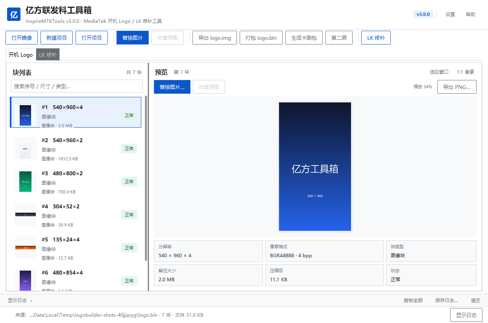
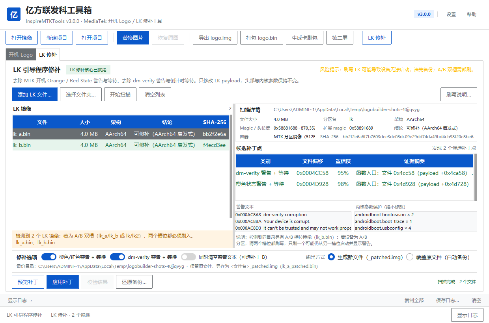
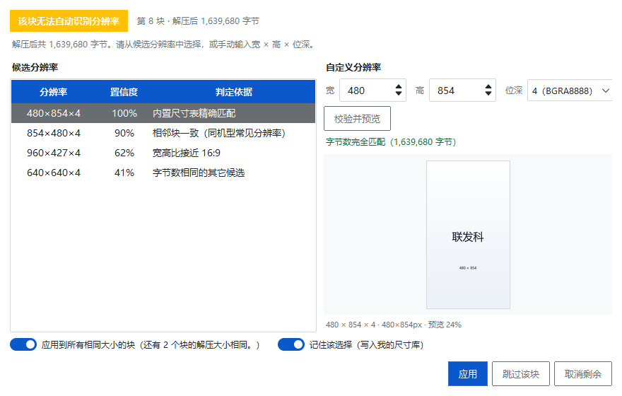
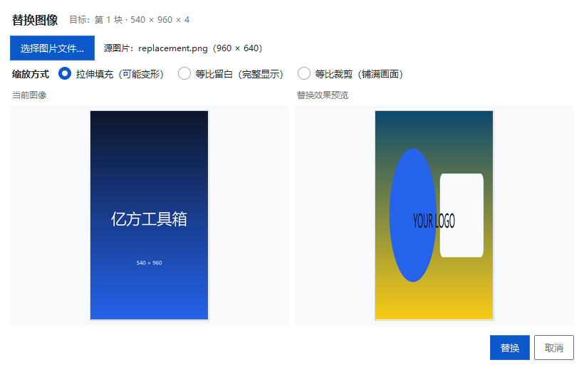

# 亿方联发科工具箱 · InspireMTKTools v3.0.0

> 一个跨平台（Windows / macOS / Linux）的 **联发科（MTK）Android 工具箱**：
> **开机 Logo 编辑器** + **LK 引导程序修补器**（去 orange-state/red-state 开机警告与 5 秒等待、去 dm-verity 警告与等待）。
>
> 前身是 2011–2015 年的闭源软件 `LogoBuilder v1.6`——本项目用 **REA** 逆向其私有格式后用 **Python 3.10+ / ttkbootstrap / Pillow / capstone** 完整重写，
> 修复原版已知缺陷（均有代码级证据），并新增现代功能。界面为 **ttkbootstrap `bootstrap-light` 主题**的全中文单语界面；GUI 与 CLI 共用同一核心库，功能可脚本化、可测试。

[](LICENSE)
[](https://www.python.org/)

- GitHub：<https://github.com/XiaoYangTech/InspireMTKTools>
- CNB：<https://cnb.cool/InspireWorks/InspireMTKTools>

```bash
git clone https://github.com/XiaoYangTech/InspireMTKTools.git      # 或
git clone https://cnb.cool/InspireWorks/InspireMTKTools.git
```

---

## 界面预览

| 主界面（Logo 编辑） | LK 修补 |
|---|---|
|  |  |

| 分辨率自动识别 | 替换图片 |
|---|---|
|  |  |

---

## 功能总览

### A. 开机 Logo（第一屏/第二屏）编辑器

- 读取 MTK 分区镜像 `logo.bin` / `logo.img`（512B 头 + 偏移表 + zlib 块；自动探测格式）
- 解出每一张图（RGB565 / BGRA8888），预览、替换、改尺寸、导出 PNG
- 重新打包 `logo.img`（可 0x00/0xFF 填充到分区大小，fastboot/SP Flash Tool 直刷）、`logo.bin`、CWM/TWRP 卡刷包 `update.zip`、第二屏 `boot_logo`
- **未修改块逐字节保留**，真实样本回包 **字节级一致**（SHA-256 相同）
- 未知尺寸自动识别：内置尺寸表 + 解压长度反查 + 相邻块投票 + 宽高比启发式 → 候选列表 + 置信度 + 实时预览
- 同字节长度布局判别：`320x480x2`（RGB565）与 `480x160x4`（不透明 BGRA8888）按 alpha 字节自动区分（`sizes.txt` 已含 480x160x4）

### B. LK 引导程序修补

- 读取 MTK `lk.img` / `lk.bin` / bootloader 组合镜像（512B 头 magic `0x58881688`、size@4、name@8、ext magic `0x58891689`；也支持裸 LK payload）
- **去除开机橙色/红色警告 + 5 秒等待**（Orange State / Red State）
- **去除 dm-verity 校验失败警告 + 等待**（dm-verity corruption / Your device is corrupt ...，约 3 秒倒计时）
- 自动架构识别与补丁点定位：
  - **ARM32 Thumb-2**（老机型）：7 条社区验证特征码精确匹配，补丁 `movs r0,#0; bx lr`
  - **AArch64**（现代机型）：capstone 反汇编 → `ADRP+ADD` 字符串引用扫描 → 锁定警告分发函数 / dm-verity 警告函数 → 入口改写为 `mov w0,wzr; ret`（**文本与等待一起消失**）
- 安全机制：自动备份、补丁前后反汇编对比、差异区间校验、**绝不改动 `androidboot.*` 内核启动参数**、fail-safe（识别不到就不写文件）、A/B 双槽提醒（lk/lk2、lk_a/lk_b 都要刷）
- 提供 `lk-info / lk-patch / lk-verify / lk-restore` 命令行

### C. 通用能力

- 跨平台 + 高分屏自适应（Windows DPI awareness、100%–200% 缩放）
- 全中文界面，统一 **ttkbootstrap bootstrap-light**（新版内置「Bootstrap 5 默认」）浅色主题
- 后台线程 + 进度 + 取消；可读中文错误 + 可复制日志
- 原版工程兼容（`header` + `.project` 导入/导出）
- 全部核心逻辑有单元/集成/GUI 测试（440+ 项），Windows 单文件 exe

---

## 快速开始

```bash
pip install -r requirements.txt      # Pillow + ttkbootstrap + capstone
python app.py                        # 图形界面（亿方联发科工具箱）
python app.py --self-test            # 自检（GUI/核心/导出/LK 全流程）
python -m logobuilder.core.cli -h    # 命令行总览
# Windows 单文件版（需要 PyInstaller）：
python tools/build_exe.py            # 产出 dist/InspireMTKTools.exe
```

> 内部 Python 包名仍为 `logobuilder`（历史兼容），对外显示名称统一为 **亿方联发科工具箱 / InspireMTKTools**。

---

## 命令行速查

### Logo

```bash
python -m logobuilder.core.cli info    logo.bin
python -m logobuilder.core.cli extract logo.bin project/     # 别名: unpack
python -m logobuilder.core.cli pack    project/ new_logo.img [--pad-to <字节数>]
python -m logobuilder.core.cli zip     new_logo.img update.zip
python -m logobuilder.core.cli bootlogo image.png boot_logo  # 别名: img2bl
python -m logobuilder.core.cli bl2img  boot_logo boot_logo.png
```

### LK 修补

```bash
python -m logobuilder.core.cli lk-info  lk.img
#   打印：头 magic/size/name/ext magic、架构（ARM32/AArch64）、警告字符串、
#   候选补丁（类别/偏移/置信度/证据）、结论

python -m logobuilder.core.cli lk-patch lk.img -o lk_patched.img \
        --categories orange_state,dm_verity --clear-text
#   默认自动生成 lk_original_backup.img；--dry-run 只预览不写盘
#   --in-place 覆盖原文件（强制先备份）

python -m logobuilder.core.cli lk-verify lk.img lk_patched.img
python -m logobuilder.core.cli lk-restore lk_original_backup.img -o lk.img
```

---

## 原版问题 → 重制版修复对照（Logo 部分）

| # | 原版问题（逆向确认） | 重制版做法 |
|---|---|---|
| B1 | 分辨率选择窗口有时不出现，或弹出后拖动卡死（`InitSizes` 因数分解失败 → 异常被吞 → 尺寸被永久写入 `ignored.txt`；滑块每次全量重绘） | 核心库完成解析；未知尺寸统一走"候选分辨率"对话框（候选+置信度+实时预览+自定义）；选择才记忆；解码在后台线程 |
| B2 | 目录选择经常出问题（自绘 Win32 `SHBrowseForFolder`/CSIDL） | tkinter 原生 `filedialog`（三平台一致），选择后校验可读写 |
| B3 | 无法在软件内替换图片 | 选中图像块 → "替换图片" → 缩放（拉伸/等比/留白/裁剪）+ 预览 → 写回项目 |
| B4 | 只识别 bin 格式，容错差 | 自动探测 LOGO 块容器 / LK raw 容器 / 裸 boot_logo；按内容判断，失败给可读原因 |
| B5 | 只能打包卡刷包，不能单独输出 LOGO IMG | 可分别导出 `logo.img`（原始分区镜像 + 可选填充）、`logo.bin`、`update.zip`、`boot_logo` |
| B6 | 无法自动识别正确分辨率 | 内置尺寸表 + 解压长度反查 + 相邻块投票 + 宽高比启发式，候选列表 + 置信度 |
| B7 | 32bpp 透明图误判、无 alpha 处理 | 显式 bpp + 正确 BGRA/RGB565 编解码，alpha 保留/合成背景 |
| B8 | 损坏输入易崩、错误信息看不懂 | 全结构校验（magic/dataLen/count/offset 越界/OOM 保护）+ typed 中文错误 + 日志 |
| B9 | 项目文件与图片不同步 | 项目校验/一键修复（缺图、尺寸不符、多余块） |
| B10 | 仅 Windows、无 HiDPI | 跨平台 + DPI 感知 + 字体/布局自适应 |

> 另有逆向发现的 13 条隐藏缺陷（如 `LastColorDepthIndex` 越界导致启动即崩）见 [docs/spec_original.md](docs/spec_original.md)。

---

## LK 修补原理（简述）与风险

- 开机警告由一个**警告分发函数**根据 boot state（2=橙 / 1、3=红）打印文本并 `mdelay(5000)`。把该函数入口改成 `mov w0,#0; ret`（AArch64）或 `movs r0,#0; bx lr`（ARM32），**警告文本和 5 秒等待一起消失**，且与原函数正常路径返回值一致。
- dm-verity 警告函数同理（打印 `dm-verity corruption` 等文本并多次短延时，约 3.0 秒）。
- 详细调研与 AArch64 逆向证据：[docs/spec_lkpatch.md](docs/spec_lkpatch.md)、[docs/lk_patch_research.md](docs/lk_patch_research.md)、[analysis/lk/](analysis/lk/)。
- ⚠️ **改 Bootloader 有变砖风险**：先备份（工具自动备份）；A/B 机型两个槽都要刷；部分机型需先解锁 seccfg（如 mtkclient）；推荐 `fastboot flash lk` 或 SP Flash Tool（Download Only，勿 Format All+Download）。
- 本工具只处理 **LK 阶段的警告文本与等待**，不等于关闭全部验证（AVB2/dm-verity/vbmeta 校验仍由系统侧决定）。
- dm-verity 补丁会一并跳过 LK 侧的 `clear_dm_verity_status`/`tran_dm_fix=1` 逻辑（原逻辑在警告路径中）；若设备出现异常可只勾选"橙色警告"、或先用 `--categories orange_state` 仅打橙色补丁。

---

## 文档索引

| 文档 | 内容 |
|---|---|
| [docs/spec_original.md](docs/spec_original.md) | 原版 LogoBuilder v1.6 逆向报告（格式/工程/卡刷包/B1–B10 + N1–N13，代码证据） |
| [docs/spec_lkpatch.md](docs/spec_lkpatch.md) | LK 修补功能规格（真实 AArch64 样本逆向、检测/补丁/校验算法、API、验收） |
| [docs/lk_patch_research.md](docs/lk_patch_research.md) | 去 orange-state / dm-verity 警告的调研报告（来源、方法分类、刷写前置、风险） |
| [docs/spec_api.md](docs/spec_api.md) | 核心库 API 契约 |
| [analysis/original_behavior.md](analysis/original_behavior.md) | 原版行为逐方法分析（SizeDialog/MainForm/Program + N1–N13） |
| [docs/original_ui_strings.md](docs/original_ui_strings.md) | 原版 UI 文案与资源清单 |
| [docs/alternatives.md](docs/alternatives.md) | 开源代替品调研（YAMLP / mtklogo / mtk-tools / mtkclient…） |
| [analysis/lk/lk_a64_analysis.md](analysis/lk/lk_a64_analysis.md) | 真实 AArch64 LK 逆向分析（警告分发器/dm-verity 函数、补丁安全性证明、规则 DB） |
| [docs/qa.md](docs/qa.md) | 测试矩阵与发布检查单 |
| [docs/REPORT.md](docs/REPORT.md) | 重制总结报告（两轮：Logo 逆向 + LK 修补；方法/证据/验证数据/限制） |
| [analysis/format/spec_bin.md](analysis/format/spec_bin.md) | logo.bin 格式独立验证（51 块清单、逐字节回包证明） |

> 说明：为控制仓库体积并尊重原软件/固件版权，**反编译 C#、IL、提取的原版资源、真机 LK 样本、测试用合成镜像**不随仓库分发；仓库内保留了可复现的脚本与分析结论（`analysis/`、`tools/`）。相关生成/分析脚本见 `tests/fixtures/`、`analysis/format/parse_logo.py`、`analysis/lk/validate_detector.py`。

---

## 许可证

本项目代码以 **MIT** 许可发布，见 [LICENSE](LICENSE)。第三方组件与参考资料（ttkbootstrap、Pillow、capstone、AOSP/CWM 卡刷模板、社区 LK 特征码来源等）按各自许可证使用，详见 [THIRD_PARTY_NOTICES.md](THIRD_PARTY_NOTICES.md)。原 `LogoBuilder v1.6` 版权归原作者；本仓库未使用其代码（仅作行为与格式的逆向研究）。真机 LK 样本仅用于本地分析、不随仓库分发。
